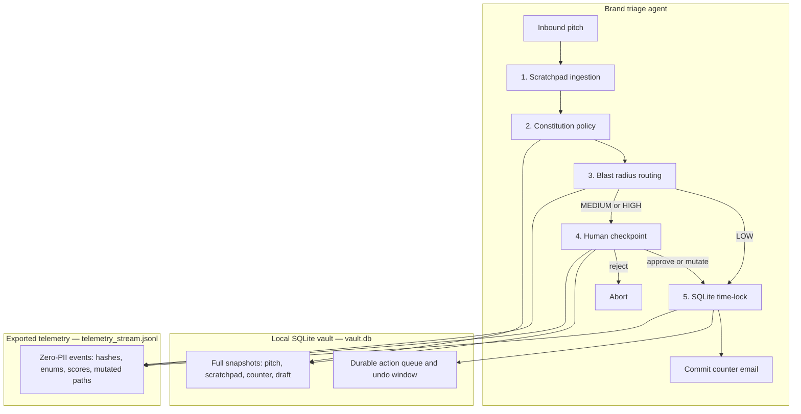

# Autonomous Brand Deal Triage Agent: A Lignos Reference Architecture

This folder is the canonical reference implementation of the Lignos governance framework. A creator partnerships lead drops an inbound sponsorship email in. The agent reads it, prices a counter from the rate card, and either stages that email behind a short undo window or stops for a person when the deal can lock a category or move real money.

Contracts, rates, and outbound email are high-stakes side effects. A fluent draft that invents a budget, dips under the floor, or grants exclusivity to sound agreeable is a real commercial commitment. The five-layer loop below is how this agent keeps that draft from becoming one until the rate card and, when needed, a person have signed off.

## The 5-layer governance loop

1. **Scratchpad Ingestion** (`src/parser.ts`) extracts the pitch with OpenAI structured outputs. The model fills `analysisScratchpad` before any field: sender, deliverables, whether a budget was stated, whitelisting, exclusivity. Unstated money stays `null`. That scratchpad is what eliminates rate hallucinations — the model is a reader, and it is not allowed to invent a number so the JSON looks finished.

2. **Constitution Policy Enforcement** (`src/rules.ts`, `.lignos/constitution.md`) prices the counter in code. The production floor is **$2,500**. Paid whitelisting adds **$1,000** to that floor. The counter is the maximum of the offered budget and the floor. **Category exclusivity under $5,000 is a blocking anti-pattern** and is declined. At $5,000 or above, exclusivity may be accepted.

3. **Blast Radius Risk Routing** (`src/risk.ts`) scores the deal. A counter at or above $5,000, a request for category exclusivity, whitelisting, or a missing budget each add weight. `LOW` continues. Anything else is routed to a person. The dollar amount and the lockup are the blast radius; the score decides who is allowed to release the side effect.

4. **Human Supervision Checkpoint** (`src/checkpoint.ts`) stops a non-low-risk deal in the terminal: approve, mutate, or reject. An edit captures taste drift directly — the new rate, the mutated field paths, and the mutation delta — so a later eval can learn what the rate card got wrong. Approving unchanged is the touchless path.

5. **Durable SQLite Time-Lock** (`src/agent.ts` via `AgentGuard`) writes the approved action to a local SQLite vault and waits out a reversible window (10 seconds in this reference) before the email is treated as sent. Kill the process during that window and the next start drains matured actions. A crash mid-dispatch is reported as in doubt and is not sent twice. The side effect stays reversible until the window closes.

The orchestration in `src/agent.ts` calls the local SDK package `@lignos/governance` (the TypeScript governance package in the Lignos SDK). `AgentGuard.executeWithGovernance` is the handoff for layers 3 through 5: snapshot, risk route, checkpoint, zero-payload telemetry, time-lock, commit.

The value proxy on the canvas is a straight-through rate of at least **75%** (STP >= 75%). Three of every four governed deals should dispatch with no operator mutation. High-risk stops are expected. A low-risk pitch that a person has to correct means the floor or the router is off.

## Quickstart

From this directory, with Node.js 20+ and an `OPENAI_API_KEY` in the environment (the parser is the only model call):

```bash
npm install
npm run agent
```

`npm run agent` runs the **low-risk** sample (Zenith Watches, $2,200, no whitelisting, no exclusivity). Policy lifts the counter to $2,500, risk stays `LOW`, and the agent auto-dispatches into the time-lock. After the undo window the commit line prints and the process exits. There is no checkpoint prompt.

```bash
npm run agent -- --high-risk
```

`npm run agent -- --high-risk` runs the **high-risk** sample (Northwind Athletics, $1,800, whitelisting, category exclusivity). Policy counters at $3,500 and declines exclusivity. Risk scores `HIGH`, and the run **halts** at the human supervision checkpoint:

```text
Action: [A]pprove (default) | [M]utate | [R]eject:
```

`A` approves the staged counter and then enters the time-lock. `M` asks for a new rate and records the mutation. `R` aborts. Nothing is dispatched until that choice is made.

Compile the intent standard into the Promptfoo suite (no API key required):

```bash
npm run evals:export
```

That writes `evals/promptfoo-suite.yaml` from `.lignos/intent-standard.json`. Run it with Promptfoo when you want a model scored against the same rate card:

```bash
npx promptfoo eval -c evals/promptfoo-suite.yaml --no-cache
```

`npm run evals:compile` is the other compiler. It reads operator mutations out of the local vault and writes `evals/generated-regressions.yaml`. The export script authors tests from the standard. The compile script authors tests from what people actually changed.

## Architecture

Full pitch text, draft emails, and dollar amounts live in the local SQLite vault. The exported telemetry stream carries hashes, route and decision enums, risk scores, latency, and the structural paths a person changed. A brand name, an email body, and a rate value stay on the machine that ran the agent.



| Store | What it holds | What leaves the machine |
|-------|----------------|-------------------------|
| `vault.db` | Raw email, scratchpad, staged and final counters, draft body, time-lock payload | Nothing. This file is the system of record for recovery and reversal. |
| `telemetry_stream.jsonl` | `governance.decision` and `timelock.*` events | Hashes, `stepId`, route, decision, risk score and level, mutation ratio, mutated key paths, timestamps. No pitch text, no draft, no dollar amounts. |

Restarting `npm run agent` after a crash calls `drainMaturedActions`. Actions whose undo window elapsed while the process was down are committed. Actions found mid-dispatch are listed as in doubt and left for a person.

## Layout

| Path | Role |
|------|------|
| `src/parser.ts` | Structured OpenAI extraction with scratchpad reasoning |
| `src/rules.ts` | Rate card: $2,500 floor, whitelisting adder, exclusivity gate |
| `src/risk.ts` | Blast-radius weights and LOW / MEDIUM / HIGH routing |
| `src/checkpoint.ts` | Terminal approve / mutate / reject |
| `src/agent.ts` | Orchestration through `@lignos/governance` |
| `.lignos/canvas.md` | JTBD, target audience, STP >= 75% value proxy |
| `.lignos/constitution.md` | Base rates and blocking anti-patterns |
| `.lignos/intent-standard.json` | Machine-readable Intent Standard |
| `scripts/export-evals.ts` | Compiles the intent standard into `evals/promptfoo-suite.yaml` |

`@lignos/governance` is the local SDK package (`packages/governance` in the Lignos SDK). Install it from a checkout with:

```bash
npm install /absolute/path/to/lignos-sdk/packages/governance
```

## Rate card

| Term | Rule |
|------|------|
| Production floor | $2,500 |
| Whitelisting | +$1,000 on the floor, only when the pitch asks |
| Counter | `max(offered budget or 0, floor)` |
| Exclusivity | Accepted only when the offered budget is at least $5,000 |
| Unstated budget | `null` in the extraction; treated as 0 by the floor math |
